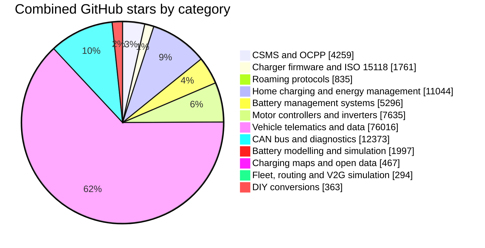

# Awesome Craft EV 

> A curated list of open-source software and hardware for electric vehicles and charging.

Open-source tools now cover most of the EV stack: charge-point backends, station firmware, home energy management, battery and motor hardware, vehicle telemetry, and the models used to study packs and routes. Every entry below has a public repository that was checked on 2026-11-15. Check each project's licence before you deploy, manufacture or sell anything built on it.

**Safety:** several hardware projects here work at pack, inverter or charger voltages. High-voltage and mains work needs qualified handling, the right personal protective equipment, and isolation procedures. This list is not instructions, training or a substitute for that.

Malaysia's public charging networks (including JomCharge, ChargeSini and chargEV) are commercial products. This snapshot did not find a verified, maintained open-source CSMS or driver app published by those networks, so no Malaysia-specific entry is listed.

## Contents

- [Dashboard](#dashboard)
- [CSMS and OCPP](#csms-and-ocpp)
- [Charger firmware and ISO 15118](#charger-firmware-and-iso-15118)
- [Roaming protocols](#roaming-protocols)
- [Home charging and energy management](#home-charging-and-energy-management)
- [Battery management systems](#battery-management-systems)
- [Motor controllers and inverters](#motor-controllers-and-inverters)
- [Vehicle telematics and data](#vehicle-telematics-and-data)
- [CAN bus and diagnostics](#can-bus-and-diagnostics)
- [Battery modelling and simulation](#battery-modelling-and-simulation)
- [Charging maps and open data](#charging-maps-and-open-data)
- [Fleet, routing and V2G simulation](#fleet-routing-and-v2g-simulation)
- [DIY conversions](#diy-conversions)
- [Open patents and pledges](#open-patents-and-pledges)
- [Related lists](#related-lists)
- [Star history](#star-history)

## Dashboard

<table>
<tr>
<td align="center"><h2>60</h2>listed projects</td>
<td align="center"><h2>12</h2>categories</td>
<td align="center"><h2>122.3k</h2>combined GitHub stars</td>
<td align="center"><h2>31.0k</h2>combined forks</td>
<td align="center"><h2>41/60</h2>pushed in the last 30 days</td>
<td align="center"><h2>15</h2>languages</td>
</tr>
</table>

**Evidence tags**

<table>
<tr><th>Tag</th><th>Style</th><th>Meaning</th></tr>
<tr><td>FACT</td><td>solid underline</td><td>A measured figure, with the source named.</td></tr>
<tr><td>GOAL</td><td>dashed underline</td><td>A stated roadmap or plan, not a result.</td></tr>
<tr><td>ESTIMATE</td><td>dotted underline</td><td>A sum or count we computed from the facts.</td></tr>
</table>

This snapshot's dashboard has no GOAL figures. None of the dashboard numbers come from project roadmaps. GOAL tags are used later, in the Open patents and pledges section, for stated plans and manufacturer claims.

**Sources and method**

- Star counts, fork counts, licences, primary languages and last-push dates are FACT values from the GitHub REST API (`GET /repos/{owner}/{repo}`) on 2026-11-15.
- Combined stars (122.3k) and combined forks (31.0k) are ESTIMATEs: the arithmetic sum of those per-repository FACT counts, with no weighting and no unique-user deduplication. A person who stars two projects is counted twice.
- Combined stars excluding openpilot: 58.2k. openpilot is ADAS software and contributes 64.1k of the total, so the list total is shown both with and without it.
- Pushed in the last 30 days (41/60) is an ESTIMATE: the number of listed repositories whose FACT `pushed_at` date is on or after 2026-10-16.
- Language and category counts, and the licence badges, are ESTIMATEs of FACT fields. Star badges next to each entry update live and may differ from this snapshot.

### 🏆 Leaderboard

Star counts in this table are FACT values from the snapshot. The bars are only a visual scale.

<table>
<tr><th>Rank</th><th>Project</th><th>Kind</th><th align="right">Stars</th><th></th></tr>
<tr><td align="center">🥇</td><td><b>openpilot</b></td><td>Vehicle telematics and data</td><td align="right">64.1k</td><td><code>████████████████████</code></td></tr>
<tr><td align="center">🥈</td><td><b>TeslaMate</b></td><td>Vehicle telematics and data</td><td align="right">9.3k</td><td><code>███</code></td></tr>
<tr><td align="center">🥉</td><td><b>evcc</b></td><td>Home charging and energy management</td><td align="right">7.6k</td><td><code>██</code></td></tr>
<tr><td align="center">4</td><td><b>ODrive</b></td><td>Motor controllers and inverters</td><td align="right">3.9k</td><td><code>█</code></td></tr>
<tr><td align="center">5</td><td><b>VESC</b></td><td>Motor controllers and inverters</td><td align="right">3.6k</td><td><code>█</code></td></tr>
<tr><td align="center">6</td><td><b>opendbc</b></td><td>CAN bus and diagnostics</td><td align="right">3.6k</td><td><code>█</code></td></tr>
<tr><td align="center">7</td><td><b>Battery Emulator</b></td><td>Battery management systems</td><td align="right">3.0k</td><td><code>█</code></td></tr>
<tr><td align="center">8</td><td><b>can-utils</b></td><td>CAN bus and diagnostics</td><td align="right">3.0k</td><td><code>█</code></td></tr>
<tr><td align="center">9</td><td><b>cantools</b></td><td>CAN bus and diagnostics</td><td align="right">2.3k</td><td><code>█</code></td></tr>
<tr><td align="center">10</td><td><b>SavvyCAN</b></td><td>CAN bus and diagnostics</td><td align="right">1.9k</td><td><code>█</code></td></tr>
</table>

### Stars by category

These category totals are ESTIMATE sums of the per-repository FACT star counts.

### Licences

         

These badge counts are ESTIMATE tallies of the SPDX identifier GitHub returned for each repository. "Custom" or "None" means GitHub could not match a standard SPDX licence. diyBMS v4 uses CC BY-NC-SA 2.0 UK, which is not an OSI licence. OICP uses CC-BY-SA-4.0, a content licence rather than a typical OSI software licence. Read each project licence before you use it commercially.

## CSMS and OCPP

- [CitrineOS](https://github.com/citrineos/citrineos-core) - LF Energy TypeScript charging station management system built around OCPP 2.0.1, with 1.6 support, an operator UI and OpenAPI APIs. 
- [Java-OCA-OCPP](https://github.com/ChargeTimeEU/Java-OCA-OCPP) - Java client and server library for OCPP 1.6 (JSON and SOAP), 2.0.1 and 2.1. 
- [ocpp](https://github.com/mobilityhouse/ocpp) - Python library for OCPP 1.6 and 2.0.1, used to build charge points and central systems. 
- [ocpp-go](https://github.com/lorenzodonini/ocpp-go) - Go implementation of OCPP-J 1.6 and 2.0.1. The release cadence has slowed, with the last push on 2025-08-24. 
- [OCPP.Core](https://github.com/dallmann-consulting/OCPP.Core) - .NET charging station management system and operator UI for OCPP 1.6 and 2.0.1. 
- [Open e-Mobility](https://github.com/sap-labs-france/ev-server) - SAP Labs France charging station management server with OCPP, roaming and smart charging. This repository is archived. 
- [open-ocpp](https://github.com/c-jimenez/open-ocpp) - C++ implementation of OCPP 1.6 and 2.0.1. Not the same project as ChargeLab's OpenOCPP. 
- [rust-ocpp](https://github.com/tommymalmqvist/rust-ocpp) - Rust message-type library for OCPP 1.6, 2.0.1 and 2.1, validated against the official schemas. 
- [SAP Charging Stations Simulator](https://github.com/SAP/e-mobility-charging-stations-simulator) - Node.js OCPP-J charge-point simulator for OCPP 1.6 and the 2.0.x line. 
- [SteVe](https://github.com/steve-community/steve) - Java charging station management system for OCPP 1.2 through 1.6 (SOAP and JSON), including the 1.6 security profiles, started at RWTH Aachen in 2013. 

## Charger firmware and ISO 15118

- [ChargePi](https://github.com/ChargePi/ChargePi-go) - Linux framework for building charge points, with hardware abstraction and OCPP support. 
- [EVerest](https://github.com/EVerest/EVerest) - LF Energy modular Linux stack for AC and DC chargers, with OCPP 1.6, 2.0.1 and 2.1 plus ISO 15118-2, -3 and -20. 
- [Josev](https://github.com/ecog-io/iso15118) - Python implementation of ISO 15118-2, -20 and -8, the protocol core of the Josev vehicle-to-grid stack (formerly SwitchEV). 
- [MicroOCPP](https://github.com/matth-x/MicroOcpp) - C++ OCPP 1.6 and 2.0.1 client for microcontrollers, used in OpenEVSE firmware. Last push 2025-12-04. 
- [OpenEVSE ESP32 firmware](https://github.com/OpenEVSE/openevse_esp32_firmware) - Wi-Fi gateway, web interface and energy-management firmware for OpenEVSE chargers. GitHub reports no SPDX licence, so read the repository before you use it. 
- [OpenOCPP](https://github.com/ChargeLab/OpenOCPP) - Multi-platform C++ OCPP 1.6 and 2.0.1 stack for charging-station firmware. Not the same project as c-jimenez/open-ocpp. 
- [SmartEVSE 3](https://github.com/SmartEVSE/SmartEVSE-3) - Open-source EVSE controller with OCPP 1.6J, smart charging and power sharing. 

## Roaming protocols

- [OCHP](https://github.com/e-clearing-net/OCHP) - Open Clearing House Protocol specification from e-clearing.net. Last push 2024-05-02. 
- [OCPI](https://github.com/ocpi/ocpi) - Official Open Charge Point Interface specification for roaming between charge-point operators and e-mobility service providers. GitHub could not match a standard SPDX licence. 
- [OCPI toolkit](https://github.com/IZIVIA/ocpi-toolkit) - Kotlin library for OCPI operations. Not affiliated with the EVRoaming Foundation. 
- [OICP](https://github.com/hubject/oicp) - Hubject Open InterCharge Protocol specification. Licensed under CC-BY-SA-4.0, which is a content licence rather than an OSI software licence. 
- [TECHS OCPI](https://github.com/TECHS-Technological-Solutions/ocpi) - Python implementation of the Open Charge Point Interface. 

## Home charging and energy management

- [EEBus](https://github.com/enbility/eebus-go) - Go implementation of the EEBus protocol for coordinating chargers and other energy devices. 
- [EMHASS](https://github.com/davidusb-geek/emhass) - Energy-management optimiser for Home Assistant, useful for scheduling EV charging against solar and prices. 
- [evcc](https://github.com/evcc-io/evcc) - Local EV charge controller and home energy management system that talks to chargers, meters, solar and vehicles. 
- [Home Assistant OCPP](https://github.com/lbbrhzn/ocpp) - Home Assistant integration for chargers that speak OCPP 1.6, 2.0.1 and experimental 2.1. 
- [OpenEMS](https://github.com/OpenEMS/openems) - Open-source energy management system, including EV charging and site energy control. 
- [openWB](https://github.com/snaptec/openWB) - Modular wallbox and home charging software (version 1). Last push 2025-07-18; new work is in openWB 2. 
- [openWB 2](https://github.com/openWB/core) - Successor core for the openWB modular wallbox and home charging software. 

## Battery management systems

- [Battery Emulator](https://github.com/dalathegreat/Battery-Emulator) - Firmware that presents reused EV battery packs to solar inverters for stationary storage. High-voltage work needs qualified handling. 
- [diyBMS v4](https://github.com/stuartpittaway/diyBMSv4) - Do-it-yourself lithium pack battery management system. Licensed under CC BY-NC-SA 2.0 UK, which is not an OSI licence and does not allow commercial use. 
- [ENNOID-BMS](https://github.com/EnnoidMe/ENNOID-BMS) - Modular LTC68XX and STM32 battery management system for packs up to 400 V. Last push 2021-07-19, so treat it as unmaintained. High-voltage work needs qualified handling. 
- [foxBMS 2](https://github.com/foxBMS/foxbms-2) - Fraunhofer modular open battery-management development platform. GitHub could not match a standard SPDX licence, so read it before you use it. High-voltage work needs qualified handling. 
- [LibreSolar BMS](https://github.com/LibreSolar/bms-firmware) - Firmware for LibreSolar battery-management boards based on bq769x0, bq769x2 or ISL94202. 

## Motor controllers and inverters

- [ODrive](https://github.com/odriverobotics/ODrive) - High-performance general-purpose motor controller also used in light EV and conversion projects. Last push 2026-01-20. 
- [OpenInverter](https://github.com/jsphuebner/stm32-sine) - Open-source inverter firmware used in many DIY EV conversions. High-voltage work needs qualified handling. 
- [VESC](https://github.com/vedderb/bldc) - Vedder Electronic Speed Controller firmware, widely used in light EVs and conversions. GitHub reports no SPDX licence, so check the project terms before you use it. 

## Vehicle telematics and data

- [bluelinky](https://github.com/Hacksore/bluelinky) - Unofficial Node.js API for Hyundai Bluelink and Kia UVO vehicle data. Last push 2025-08-13. 
- [openpilot](https://github.com/commaai/openpilot) - comma's open driver-assistance system. It is ADAS software, not an EV charging or powertrain stack, though it supports some electric vehicles. 
- [OVMS](https://github.com/openvehicles/Open-Vehicle-Monitoring-System-3) - Open Vehicle Monitoring System for remote telemetry and control of many EV models. GitHub could not match a standard SPDX licence. 
- [PSA Car Controller](https://github.com/flobz/psa_car_controller) - Control and telemetry for Stellantis (PSA) connected cars, including electric models. 
- [TeslaLogger](https://github.com/bassmaster187/TeslaLogger) - Self-hosted data logger for Tesla vehicles. 
- [TeslaMate](https://github.com/teslamate-org/teslamate) - Self-hosted Tesla data logger with Grafana dashboards and MQTT. 

## CAN bus and diagnostics

- [can-utils](https://github.com/linux-can/can-utils) - Linux SocketCAN userspace tools such as candump and cansend. GitHub reports no SPDX licence, so confirm the terms in the repository. 
- [cantools](https://github.com/cantools/cantools) - Python tools for DBC decoding, monitoring and simulation of CAN buses. 
- [opendbc](https://github.com/commaai/opendbc) - Python API and CAN database collection for reading car signals, maintained by comma. 
- [python-can](https://github.com/hardbyte/python-can) - Python library for sending and receiving CAN messages across common interfaces. 
- [SavvyCAN](https://github.com/collin80/SavvyCAN) - Cross-platform Qt application for capturing, inspecting and decoding CAN traffic. 

## Battery modelling and simulation

- [BattMo](https://github.com/BattMoTeam/BattMo) - Continuum battery modelling toolbox in MATLAB. 
- [BLAST-Lite](https://github.com/NatLabRockies/BLAST-Lite) - NREL Battery Lifetime Analysis and Simulation Toolsuite, with degradation models for recent commercial lithium-ion cells. The live GitHub repository is NatLabRockies/BLAST-Lite. 
- [liionpack](https://github.com/pybamm-team/liionpack) - Battery-pack simulation tool built on the PyBaMM framework. 
- [PyBaMM](https://github.com/pybamm-team/PyBaMM) - Fast, flexible physics-based battery models in Python. 

## Charging maps and open data

- [EVMap](https://github.com/ev-map/EVMap) - Android app for finding public charge points, using community and open data. 
- [Open Charge Map](https://github.com/openchargemap/ocm-system) - Global public registry of EV charging locations, with an open API and community contributions. 
- [Open EV Data](https://github.com/open-ev-data/open-ev-data-dataset) - Community-maintained, versioned dataset of electric-vehicle specifications. GitHub could not match a standard SPDX licence. 

## Fleet, routing and V2G simulation

- [EV2Gym](https://github.com/StavrosOrf/EV2Gym) - Vehicle-to-grid simulation environment for large-scale EV charging optimisation research. 
- [Pumperly](https://github.com/GeiserX/Pumperly) - Self-hostable fuel and EV route planner with live prices in supported countries. 

## DIY conversions

- [ccs32clara](https://github.com/uhi22/ccs32clara) - STM32 and QCA7005 CCS charge-controller project for DIY and research use. High-voltage and mains work needs qualified handling. 
- [OpenInverter VCU](https://github.com/jsphuebner/stm32-vcu) - Vehicle control unit for EV conversion projects, a companion to the OpenInverter firmware. High-voltage work needs qualified handling. 
- [pyPLC](https://github.com/uhi22/pyPLC) - Python tools for investigating CCS and ISO 15118 charging at the power-line communication layer. High-voltage work needs qualified handling. 

## Open patents and pledges

This section is a research summary of public statements and patent records, not legal advice. Patent pledges and royalty-free programmes have conditions, time limits and exceptions. A listing here does not grant a licence, confirm that a patent is in force, or mean it is free to use. Read the official terms and get legal advice before relying on any pledge.

Figures and statements below use the same evidence tags as the dashboard: FACT from a named source, GOAL for a stated plan or an unmeasured manufacturer claim, and ESTIMATE for counts this project computed. Source notes and export limits are in [data/README.md](data/README.md). The machine-readable files are [tesla-patents.csv](data/tesla-patents.csv), [byd-patents.csv](data/byd-patents.csv) and [ev-patent-pledges.csv](data/ev-patent-pledges.csv).

### Tesla Patent Pledge

On 12 June 2014, Tesla published [All Our Patent Are Belong To You](https://www.tesla.com/blog/all-our-patent-are-belong-you), announcing that it "will not initiate patent lawsuits against anyone who, in good faith, wants to use our technology."

The current legal terms are on Tesla's [Additional Resources](https://www.tesla.com/legal/additional-resources) page (anchors `#patent-pledge` and `#patent-list`). As of the archives checked for this snapshot, those terms say:

<table>
<tr><th>Term</th><th>What Tesla's legal page says</th></tr>
<tr><td>Pledge</td><td>Tesla irrevocably pledges that it will not initiate a lawsuit against any party for infringing a Tesla Patent through activity relating to electric vehicles or related equipment for so long as that party is acting in good faith.</td></tr>
<tr><td>Legal effect</td><td>The pledge is a standstill (forbearance of enforcement). It is not a licence, covenant not to sue, waiver, or authorisation to practise the patents.</td></tr>
<tr><td>Good faith</td><td>Good faith excludes, among other things, asserting intellectual property rights against Tesla, asserting patent rights against a third party for use of electric-vehicle technologies, challenging Tesla patents, or marketing knock-off Tesla products.</td></tr>
<tr><td>Tesla Patents</td><td>This means all patents owned now or in the future by Tesla, other than a patent owned jointly with a third party or a later-acquired patent that comes with an encumbrance that prevents it from being subject to the pledge.</td></tr>
<tr><td>List</td><td>Tesla says a list of Tesla Patents subject to the pledge will be maintained on that legal page.</td></tr>
</table>

Tesla does not publish filing dates, legal status or CPC classes on that list, and this project does not treat the list as a complete legal map of the broader "now or in the future" definition.

The itemised table was recovered from official-page archives dated 6 May 2019 and 8 January 2024 (see data/README.md for the Wayback captures). Both captures contain the same 361 entries. 249 of those numbers are US filings; the rest are AU, CA, CN, DE, EP, FR, GB, HK, JP or KR, so 361 is not 361 distinct inventions. 163 official numbers were matched to a Google Patents record in this snapshot so that dates and a precise document id could be added; the other rows have a search link only. The export is data/tesla-patents.csv.

A 12 March 2025 archive of the same legal page still has the pledge wording and the `#patent-list` URL, but the captured HTML does not include the itemised table.

A separate Google Patents assignee export on 15 November 2026 found 1139 Tesla-related records after filtering out unrelated assignees. 163 of those also appear on the official 361-entry list. That Google Patents file is a public-database supplement, not Tesla's itemisation of pledge coverage, and it is saved as [tesla-patents-google.csv](data/tesla-patents-google.csv).

### NACS and SAE J3400

On 11 November 2022, Tesla published [Opening the North American Charging Standard](https://www.tesla.com/blog/opening-north-american-charging-standard). It invited charging networks and vehicle makers to use the Tesla connector and charge port, then renamed NACS, and said the design and specification files were available for download while Tesla worked with standards bodies.

Tesla's [Charging & Adapter Product Guides](https://www.tesla.com/support/charging/product-guides) were later updated on 30 September 2024: as NACS is recognised in an SAE Recommended Practice under SAE J3400, Tesla removed the technical specifications and CAD from its website and said those files are now available in the SAE J3400 Recommended Practice.

SAE J3400_202409, [North American Charging System (NACS) for Electric Vehicles](https://saemobilus.sae.org/standards/j3400_202409-north-american-charging-system-nacs-electric-vehicles), is the SAE Recommended Practice dated September 2024. This is an opened connector design that became a public standard, not a patent pledge. Performance comparisons in Tesla's 2022 blog, including "up to 1 MW DC charging", are Tesla's own statements.

### Other pledges and licences

<table>
<tr><th>Programme</th><th>When</th><th>What it is</th><th>Official source</th></tr>
<tr>
<td>Toyota fuel-cell licences</td>
<td>6 January 2015</td>
<td>Royalty-free licences on about 5,680 FCV-related patents, under a contract with Toyota. Licences for manufacturing and selling FCVs were offered through the initial market introduction period, anticipated until about the end of 2020 — that stated window has ended. About 70 hydrogen-station patents were said to remain open for an unlimited duration.</td>
<td><a href="https://global.toyota/en/detail/4663648">Toyota global release</a></td>
</tr>
<tr>
<td>Toyota electrification licences</td>
<td>3 April 2019</td>
<td>Royalty-free licences on nearly 24,000 patents (Toyota's own figure is approximately 23,740) for vehicle electrification technologies, through the end of 2030, under a contract. Separate technical support is fee-based. The end-2030 date is a stated term (GOAL of the programme's duration, as published by Toyota).</td>
<td><a href="https://global.toyota/en/newsroom/corporate/27512455.html">Toyota newsroom</a></td>
</tr>
<tr>
<td>Ford electrified-vehicle patents</td>
<td>28 May 2015</td>
<td>Ford offered competitors access to its electrified-vehicle patent portfolio. It said it had more than 650 electrified-vehicle patents and approximately 1,000 pending applications. The patents were available for a fee — this is licensing, not a free pledge.</td>
<td><a href="https://media.ford.com/content/fordmedia/fna/us/en/news/2015/05/28/ford-opens-portfolio-of-patented-technologies-to-competitors-to-.html">Ford Media announcement</a></td>
</tr>
<tr>
<td>Low Carbon Patent Pledge</td>
<td>22 April 2021</td>
<td>A royalty-free licence, launched by Hewlett Packard Enterprise, Microsoft and Meta, limited to practising pledged patents for the use, generation, storage or distribution of low-carbon energy from solar, wind, ocean, hydropower or geothermal sources. It is not a general EV-vehicle patent pledge. The licence has a defensive-termination clause. LCPP later said 563 pledged patents had been uploaded to WIPO GREEN.</td>
<td><a href="https://lowcarbonpatentpledge.org/the-pledge/">The Pledge</a></td>
</tr>
<tr>
<td>Eco-Patent Commons</td>
<td>January 2008 – May 2016</td>
<td>A shared commons for environmentally beneficial patents. It was discontinued in May 2016.</td>
<td><a href="https://houstonlawreview.org/article/10854-pledging-patents-for-the-public-good-rise-and-fall-of-the-eco-patent-commons">Houston Law Review history</a></td>
</tr>
</table>

Volvo's 2024 electric-sales announcements were about vehicle-mix targets, not an open patent pledge, so they are not listed. This snapshot also did not find a verified official GM or Hyundai open EV patent pledge, and it does not treat Open Invention Network or LOT Network as EV patent pledges (they are defensive patent networks).

### BYD technology

No verified BYD patent pledge or royalty-free patent licence was found in this snapshot. The rows in data/byd-patents.csv are public patent records, not open patents.

Google Patents assignee exports for "BYD Co Ltd" and "BYD Company Limited" on 15 November 2026 produced 33,254 unique BYD-assignee records before filtering (ESTIMATE, and possibly incomplete). After a title-keyword filter for EV-relevant filings, 3,934 records remain, of which 446 match a focus topic: Blade Battery or 刀片 (9), LFP or cell-to-pack (61), e-Platform or 8-in-1 (7), DM-i or hybrid (368), cell-to-body (1), and Super e-Platform or megawatt flash charging (0). Those tag counts are keyword ESTIMATEs. Marketing names rarely appear in patent titles, so they are not a catalogue of every related filing.

Official BYD technology pages, with stated specs tagged as claims unless independently measured here:

- [Blade Battery](https://en.byd.com/news/byds-new-blade-battery-set-to-redefine-ev-safety-standards/) - BYD said long cells are arranged in an array in the pack and that pack space utilisation increased by over 50% compared with conventional lithium-iron-phosphate block batteries. A later official EU page, [BYD's revolutionary Blade Battery](https://www.byd.com/eu/blog/BYDs-revolutionary-Blade-Battery-all-you-need-to-know.html), says the Blade Battery was launched in March 2020 and describes this as BYD CTP (cell-to-pack) technology. Partnership language on the announcement page about sharing the technology with global partners is not a patent pledge.
- [e-Platform 3.0](https://en.byd.com/news/byd-debuts-e-platform-3-0-leading-the-next-generation-of-smart-electric-vehicles/) - Officially debuted on 19 April 2021 at the Shanghai Auto Show. BYD said the platform "will continue to be open to the industry." That is a stated product-platform policy, not an open-source software licence and not a patent pledge. A later official EU page, [Why is BYD's e-Platform 3.0 so special?](https://www.byd.com/eu/blog/Why-is-BYDs-e-Platform-3-0-so-special.html), describes the platform as launched in September 2021. Manufacturer-stated figures from those pages — including 89% system efficiency, 800 V fast charging, 5 minutes of charge for 90 miles, a 0.21 drag coefficient, and a vehicle OS "fully open to developers" — are BYD claims, not measurements made for this list. The same debut release introduced the 2021 Tang DM-i super-hybrid and stated fuel consumption as low as 1.4 gallons per 60 miles with a comprehensive range of 600 miles.
- [Cell-to-body (CTB)](https://www.byd.com/eu/news-list/BYD_SEAL_Dynamic_and_Intelligent) - Presented with the BYD SEAL on 12 April 2023. BYD said SEAL is the first vehicle to implement CTB, integrating the Blade Battery into the body. Stated figures such as 66% pack volume utilisation, 10% system energy density and 40,500 N·m/degree torsional stiffness are BYD claims.
- [Super e-Platform](https://www.byd.com/en/news-list/BYD-Unveils-Super-e-Platform-Megawatt-Flash-Charging-Electric-Vehicles-Matching-Refueling-Speeds) - Unveiled on 17 March 2025. BYD described a full-domain 1000 V architecture, 1000 kW megawatt flash charging, a peak of 2 km of range per second, and 400 km of range in 5 minutes, first on the Han L and Tang L in China. It also said it plans to build over 4,000 megawatt flash-charging stations in China. Those charging performance figures and the station rollout are BYD's stated specs and plans, not independent measurements.

On open software and developer access, this snapshot found BYD's DiLink / open-innovation site at [oip.byd.com](https://oip.byd.com/) (比亚迪汽车工业有限公司). The page itself did not load from this environment, so its current developer terms were not verified here. No official BYD Company GitHub organisation was verified: `github.com/byd` is a personal account, and `github.com/BYDcar` is not listed here as an official BYD release.

## Related lists

Other lists in the Awesome Craft series:

- [Awesome Craft](https://github.com/EdisonTKPcom/Awesome-Craft) - A curated list of open-source, self-hostable alternatives to popular SaaS tools.
- [Awesome Craft Agents](https://github.com/EdisonTKPcom/Awesome-Craft-Agents) - A curated list of open-source chat apps, coding agents, self-hosted agent bots, workflow automation and image-generation UIs.
- [Awesome Craft AI](https://github.com/EdisonTKPcom/Awesome-Craft-AI) - A curated list of open-source, self-hostable AI runtimes, servers, Hugging Face libraries and related infrastructure.
- [Awesome Craft BSC](https://github.com/EdisonTKPcom/Awesome-Craft-BSC) - A curated list of verified open-source clients, SDKs, dev tools and protocol code for BNB Smart Chain and opBNB.
- [Awesome Craft Creative](https://github.com/EdisonTKPcom/Awesome-Craft-Creative) - A curated list of open-source creative apps, including the storytold Craft App Suite and tools for photo, video, animation, 3D, audio and design.
- [Awesome Craft CUDA](https://github.com/EdisonTKPcom/Awesome-Craft-CUDA) - A curated list of open-source CUDA learning material, kernel libraries, tooling and portability projects.
- [Awesome Craft DeepSeek](https://github.com/EdisonTKPcom/Awesome-Craft-DeepSeek) - A curated list of official DeepSeek repositories and open-source harnesses, serving engines, eval tools and fine-tuning stacks that work with DeepSeek models.
- [Awesome Craft DevOps](https://github.com/EdisonTKPcom/Awesome-Craft-DevOps) - A curated list of open-source, self-hostable alternatives to popular DevOps and hosting SaaS tools.
- [Awesome Craft DNA](https://github.com/EdisonTKPcom/Awesome-Craft-DNA) - A curated list of open-source tools for DNA, genomics and synthetic biology.
- [Awesome Craft Ethereum](https://github.com/EdisonTKPcom/Awesome-Craft-Ethereum) - A curated list of verified open-source Ethereum clients, SDKs, dev frameworks, wallets and security tools.
- [Awesome Craft Hardware](https://github.com/EdisonTKPcom/Awesome-Craft-Hardware) - A curated list of open-source tools for PCB, FPGA, ASIC and chip design.
- [Awesome Craft Hyperliquid](https://github.com/EdisonTKPcom/Awesome-Craft-Hyperliquid) - A curated list of verified open-source SDKs, node tools, analytics and community libraries for the Hyperliquid ecosystem.
- [Awesome Craft Jarvis](https://github.com/EdisonTKPcom/Awesome-Craft-Jarvis) - A curated list of open-source tools to run a personal JARVIS-style AI assistant locally, including dashboards, agent runtimes, voice, MCP connections and memory.
- [Awesome Craft Malaysia](https://github.com/EdisonTKPcom/Awesome-Craft-Malaysia) - A curated list of open-source tools useful to Malaysian SMEs, with verified MyInvois support called out separately.
- [Awesome Craft Mars](https://github.com/EdisonTKPcom/Awesome-Craft-Mars) - A curated list of open-source tools and open data for Mars missions and settlement planning.
- [Awesome Craft Neuro](https://github.com/EdisonTKPcom/Awesome-Craft-Neuro) - A curated list of open-source tools for brain-computer interfaces, electrophysiology and neurotechnology.
- [Awesome Craft Robotics](https://github.com/EdisonTKPcom/Awesome-Craft-Robotics) - A curated list of open-source robotics software and hardware, including Microduck, Unitree SDKs, open humanoids, arms, simulation and middleware.
- [Awesome Craft Solana](https://github.com/EdisonTKPcom/Awesome-Craft-Solana) - A curated list of verified open-source Solana clients, SDKs, frameworks, explorers and program libraries.
- [Awesome Craft Space](https://github.com/EdisonTKPcom/Awesome-Craft-Space) - A curated list of open-source tools for spaceflight and rockets, covering orbit simulation, telemetry, launch data and more.
- [Awesome Craft Starlink](https://github.com/EdisonTKPcom/Awesome-Craft-Starlink) - A curated list of open-source tools for Starlink and other LEO satellite internet systems.
- [Awesome Craft Web3](https://github.com/EdisonTKPcom/Awesome-Craft-Web3) - A curated list of open-source DEX protocol code, self-custody software, indexers, frameworks and Blockchain infrastructure.

## Star history

## Contributing

Contributions welcome! Read the [contribution guidelines](contributing.md) first.

If this list helped you find a tool, give it a ⭐ so others can find it.

