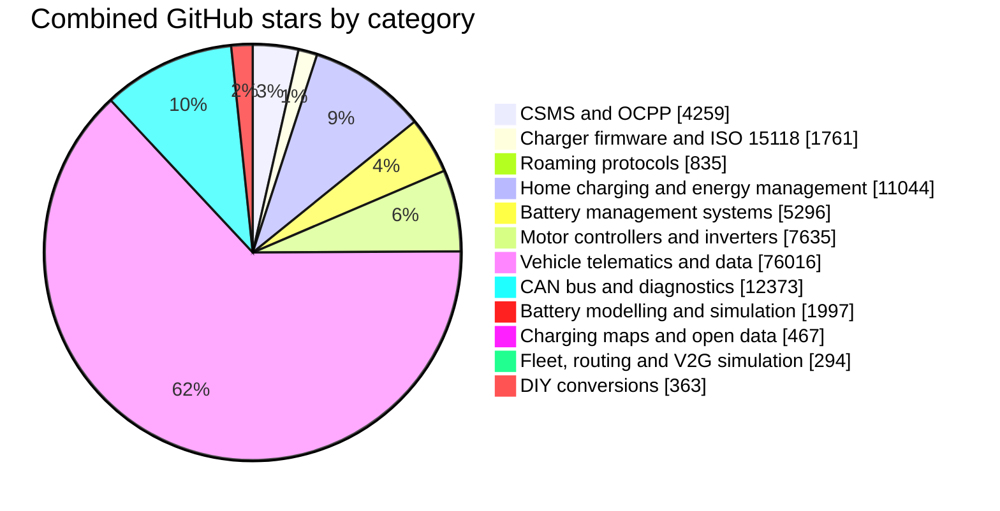

# Awesome Craft EV 

> A curated list of open-source software and hardware for electric vehicles and charging.

Open-source tools now cover most of the EV stack: charge-point backends, station firmware, home energy management, battery and motor hardware, vehicle telemetry, and the models used to study packs and routes. Every entry below has a public repository that was checked on 2026-11-15. Check each project's licence before you deploy, manufacture or sell anything built on it.

**Safety:** several hardware projects here work at pack, inverter or charger voltages. High-voltage and mains work needs qualified handling, the right personal protective equipment, and isolation procedures. This list is not instructions, training or a substitute for that.

Malaysia's public charging networks (including JomCharge, ChargeSini and chargEV) are commercial products. This snapshot did not find a verified, maintained open-source CSMS or driver app published by those networks, so no Malaysia-specific entry is listed.

Related lists: [Awesome Craft](https://github.com/EdisonTKPcom/Awesome-Craft), [Awesome Craft Hardware](https://github.com/EdisonTKPcom/Awesome-Craft-Hardware).

## Contents

- [Dashboard](#dashboard)
- [CSMS and OCPP](#csms-and-ocpp)
- [Charger firmware and ISO 15118](#charger-firmware-and-iso-15118)
- [Roaming protocols](#roaming-protocols)
- [Home charging and energy management](#home-charging-and-energy-management)
- [Battery management systems](#battery-management-systems)
- [Motor controllers and inverters](#motor-controllers-and-inverters)
- [Vehicle telematics and data](#vehicle-telematics-and-data)
- [CAN bus and diagnostics](#can-bus-and-diagnostics)
- [Battery modelling and simulation](#battery-modelling-and-simulation)
- [Charging maps and open data](#charging-maps-and-open-data)
- [Fleet, routing and V2G simulation](#fleet-routing-and-v2g-simulation)
- [DIY conversions](#diy-conversions)

## Dashboard

<table>
<tr>
<td align="center"><h2>60</h2>listed projects</td>
<td align="center"><h2>12</h2>categories</td>
<td align="center"><h2>122.3k</h2>combined GitHub stars</td>
<td align="center"><h2>31.0k</h2>combined forks</td>
<td align="center"><h2>41/60</h2>pushed in the last 30 days</td>
<td align="center"><h2>15</h2>languages</td>
</tr>
</table>

**Evidence tags**

<table>
<tr><th>Tag</th><th>Style</th><th>Meaning</th></tr>
<tr><td>FACT</td><td>solid underline</td><td>A measured figure, with the source named.</td></tr>
<tr><td>GOAL</td><td>dashed underline</td><td>A stated roadmap or plan, not a result.</td></tr>
<tr><td>ESTIMATE</td><td>dotted underline</td><td>A sum or count we computed from the facts.</td></tr>
</table>

This snapshot has no GOAL figures. None of the dashboard numbers come from project roadmaps.

**Sources and method**

- Star counts, fork counts, licences, primary languages and last-push dates are FACT values from the GitHub REST API (`GET /repos/{owner}/{repo}`) on 2026-11-15.
- Combined stars (122.3k) and combined forks (31.0k) are ESTIMATEs: the arithmetic sum of those per-repository FACT counts, with no weighting and no unique-user deduplication. A person who stars two projects is counted twice.
- Combined stars excluding openpilot: 58.2k. openpilot is ADAS software and contributes 64.1k of the total, so the list total is shown both with and without it.
- Pushed in the last 30 days (41/60) is an ESTIMATE: the number of listed repositories whose FACT `pushed_at` date is on or after 2026-10-16.
- Language and category counts, and the licence badges, are ESTIMATEs of FACT fields. Star badges next to each entry update live and may differ from this snapshot.

### 🏆 Leaderboard

Star counts in this table are FACT values from the snapshot. The bars are only a visual scale.

<table>
<tr><th>Rank</th><th>Project</th><th>Kind</th><th align="right">Stars</th><th></th></tr>
<tr><td align="center">🥇</td><td><b>openpilot</b></td><td>Vehicle telematics and data</td><td align="right">64.1k</td><td><code>████████████████████</code></td></tr>
<tr><td align="center">🥈</td><td><b>TeslaMate</b></td><td>Vehicle telematics and data</td><td align="right">9.3k</td><td><code>███</code></td></tr>
<tr><td align="center">🥉</td><td><b>evcc</b></td><td>Home charging and energy management</td><td align="right">7.6k</td><td><code>██</code></td></tr>
<tr><td align="center">4</td><td><b>ODrive</b></td><td>Motor controllers and inverters</td><td align="right">3.9k</td><td><code>█</code></td></tr>
<tr><td align="center">5</td><td><b>VESC</b></td><td>Motor controllers and inverters</td><td align="right">3.6k</td><td><code>█</code></td></tr>
<tr><td align="center">6</td><td><b>opendbc</b></td><td>CAN bus and diagnostics</td><td align="right">3.6k</td><td><code>█</code></td></tr>
<tr><td align="center">7</td><td><b>Battery Emulator</b></td><td>Battery management systems</td><td align="right">3.0k</td><td><code>█</code></td></tr>
<tr><td align="center">8</td><td><b>can-utils</b></td><td>CAN bus and diagnostics</td><td align="right">3.0k</td><td><code>█</code></td></tr>
<tr><td align="center">9</td><td><b>cantools</b></td><td>CAN bus and diagnostics</td><td align="right">2.3k</td><td><code>█</code></td></tr>
<tr><td align="center">10</td><td><b>SavvyCAN</b></td><td>CAN bus and diagnostics</td><td align="right">1.9k</td><td><code>█</code></td></tr>
</table>

### Stars by category

These category totals are ESTIMATE sums of the per-repository FACT star counts.

### Licences

         

These badge counts are ESTIMATE tallies of the SPDX identifier GitHub returned for each repository. "Custom" or "None" means GitHub could not match a standard SPDX licence. diyBMS v4 uses CC BY-NC-SA 2.0 UK, which is not an OSI licence. OICP uses CC-BY-SA-4.0, a content licence rather than a typical OSI software licence. Read each project licence before you use it commercially.

## CSMS and OCPP

- [CitrineOS](https://github.com/citrineos/citrineos-core) - LF Energy TypeScript charging station management system built around OCPP 2.0.1, with 1.6 support, an operator UI and OpenAPI APIs. 
- [Java-OCA-OCPP](https://github.com/ChargeTimeEU/Java-OCA-OCPP) - Java client and server library for OCPP 1.6 (JSON and SOAP), 2.0.1 and 2.1. 
- [ocpp](https://github.com/mobilityhouse/ocpp) - Python library for OCPP 1.6 and 2.0.1, used to build charge points and central systems. 
- [ocpp-go](https://github.com/lorenzodonini/ocpp-go) - Go implementation of OCPP-J 1.6 and 2.0.1. The release cadence has slowed, with the last push on 2025-08-24. 
- [OCPP.Core](https://github.com/dallmann-consulting/OCPP.Core) - .NET charging station management system and operator UI for OCPP 1.6 and 2.0.1. 
- [Open e-Mobility](https://github.com/sap-labs-france/ev-server) - SAP Labs France charging station management server with OCPP, roaming and smart charging. This repository is archived. 
- [open-ocpp](https://github.com/c-jimenez/open-ocpp) - C++ implementation of OCPP 1.6 and 2.0.1. Not the same project as ChargeLab's OpenOCPP. 
- [rust-ocpp](https://github.com/tommymalmqvist/rust-ocpp) - Rust message-type library for OCPP 1.6, 2.0.1 and 2.1, validated against the official schemas. 
- [SAP Charging Stations Simulator](https://github.com/SAP/e-mobility-charging-stations-simulator) - Node.js OCPP-J charge-point simulator for OCPP 1.6 and the 2.0.x line. 
- [SteVe](https://github.com/steve-community/steve) - Java charging station management system for OCPP 1.2 through 1.6 (SOAP and JSON), including the 1.6 security profiles, started at RWTH Aachen in 2013. 

## Charger firmware and ISO 15118

- [ChargePi](https://github.com/ChargePi/ChargePi-go) - Linux framework for building charge points, with hardware abstraction and OCPP support. 
- [EVerest](https://github.com/EVerest/EVerest) - LF Energy modular Linux stack for AC and DC chargers, with OCPP 1.6, 2.0.1 and 2.1 plus ISO 15118-2, -3 and -20. 
- [Josev](https://github.com/ecog-io/iso15118) - Python implementation of ISO 15118-2, -20 and -8, the protocol core of the Josev vehicle-to-grid stack (formerly SwitchEV). 
- [MicroOCPP](https://github.com/matth-x/MicroOcpp) - C++ OCPP 1.6 and 2.0.1 client for microcontrollers, used in OpenEVSE firmware. Last push 2025-12-04. 
- [OpenEVSE ESP32 firmware](https://github.com/OpenEVSE/openevse_esp32_firmware) - Wi-Fi gateway, web interface and energy-management firmware for OpenEVSE chargers. GitHub reports no SPDX licence, so read the repository before you use it. 
- [OpenOCPP](https://github.com/ChargeLab/OpenOCPP) - Multi-platform C++ OCPP 1.6 and 2.0.1 stack for charging-station firmware. Not the same project as c-jimenez/open-ocpp. 
- [SmartEVSE 3](https://github.com/SmartEVSE/SmartEVSE-3) - Open-source EVSE controller with OCPP 1.6J, smart charging and power sharing. 

## Roaming protocols

- [OCHP](https://github.com/e-clearing-net/OCHP) - Open Clearing House Protocol specification from e-clearing.net. Last push 2024-05-02. 
- [OCPI](https://github.com/ocpi/ocpi) - Official Open Charge Point Interface specification for roaming between charge-point operators and e-mobility service providers. GitHub could not match a standard SPDX licence. 
- [OCPI toolkit](https://github.com/IZIVIA/ocpi-toolkit) - Kotlin library for OCPI operations. Not affiliated with the EVRoaming Foundation. 
- [OICP](https://github.com/hubject/oicp) - Hubject Open InterCharge Protocol specification. Licensed under CC-BY-SA-4.0, which is a content licence rather than an OSI software licence. 
- [TECHS OCPI](https://github.com/TECHS-Technological-Solutions/ocpi) - Python implementation of the Open Charge Point Interface. 

## Home charging and energy management

- [EEBus](https://github.com/enbility/eebus-go) - Go implementation of the EEBus protocol for coordinating chargers and other energy devices. 
- [EMHASS](https://github.com/davidusb-geek/emhass) - Energy-management optimiser for Home Assistant, useful for scheduling EV charging against solar and prices. 
- [evcc](https://github.com/evcc-io/evcc) - Local EV charge controller and home energy management system that talks to chargers, meters, solar and vehicles. 
- [Home Assistant OCPP](https://github.com/lbbrhzn/ocpp) - Home Assistant integration for chargers that speak OCPP 1.6, 2.0.1 and experimental 2.1. 
- [OpenEMS](https://github.com/OpenEMS/openems) - Open-source energy management system, including EV charging and site energy control. 
- [openWB](https://github.com/snaptec/openWB) - Modular wallbox and home charging software (version 1). Last push 2025-07-18; new work is in openWB 2. 
- [openWB 2](https://github.com/openWB/core) - Successor core for the openWB modular wallbox and home charging software. 

## Battery management systems

- [Battery Emulator](https://github.com/dalathegreat/Battery-Emulator) - Firmware that presents reused EV battery packs to solar inverters for stationary storage. High-voltage work needs qualified handling. 
- [diyBMS v4](https://github.com/stuartpittaway/diyBMSv4) - Do-it-yourself lithium pack battery management system. Licensed under CC BY-NC-SA 2.0 UK, which is not an OSI licence and does not allow commercial use. 
- [ENNOID-BMS](https://github.com/EnnoidMe/ENNOID-BMS) - Modular LTC68XX and STM32 battery management system for packs up to 400 V. Last push 2021-07-19, so treat it as unmaintained. High-voltage work needs qualified handling. 
- [foxBMS 2](https://github.com/foxBMS/foxbms-2) - Fraunhofer modular open battery-management development platform. GitHub could not match a standard SPDX licence, so read it before you use it. High-voltage work needs qualified handling. 
- [LibreSolar BMS](https://github.com/LibreSolar/bms-firmware) - Firmware for LibreSolar battery-management boards based on bq769x0, bq769x2 or ISL94202. 

## Motor controllers and inverters

- [ODrive](https://github.com/odriverobotics/ODrive) - High-performance general-purpose motor controller also used in light EV and conversion projects. Last push 2026-01-20. 
- [OpenInverter](https://github.com/jsphuebner/stm32-sine) - Open-source inverter firmware used in many DIY EV conversions. High-voltage work needs qualified handling. 
- [VESC](https://github.com/vedderb/bldc) - Vedder Electronic Speed Controller firmware, widely used in light EVs and conversions. GitHub reports no SPDX licence, so check the project terms before you use it. 

## Vehicle telematics and data

- [bluelinky](https://github.com/Hacksore/bluelinky) - Unofficial Node.js API for Hyundai Bluelink and Kia UVO vehicle data. Last push 2025-08-13. 
- [openpilot](https://github.com/commaai/openpilot) - comma's open driver-assistance system. It is ADAS software, not an EV charging or powertrain stack, though it supports some electric vehicles. 
- [OVMS](https://github.com/openvehicles/Open-Vehicle-Monitoring-System-3) - Open Vehicle Monitoring System for remote telemetry and control of many EV models. GitHub could not match a standard SPDX licence. 
- [PSA Car Controller](https://github.com/flobz/psa_car_controller) - Control and telemetry for Stellantis (PSA) connected cars, including electric models. 
- [TeslaLogger](https://github.com/bassmaster187/TeslaLogger) - Self-hosted data logger for Tesla vehicles. 
- [TeslaMate](https://github.com/teslamate-org/teslamate) - Self-hosted Tesla data logger with Grafana dashboards and MQTT. 

## CAN bus and diagnostics

- [can-utils](https://github.com/linux-can/can-utils) - Linux SocketCAN userspace tools such as candump and cansend. GitHub reports no SPDX licence, so confirm the terms in the repository. 
- [cantools](https://github.com/cantools/cantools) - Python tools for DBC decoding, monitoring and simulation of CAN buses. 
- [opendbc](https://github.com/commaai/opendbc) - Python API and CAN database collection for reading car signals, maintained by comma. 
- [python-can](https://github.com/hardbyte/python-can) - Python library for sending and receiving CAN messages across common interfaces. 
- [SavvyCAN](https://github.com/collin80/SavvyCAN) - Cross-platform Qt application for capturing, inspecting and decoding CAN traffic. 

## Battery modelling and simulation

- [BattMo](https://github.com/BattMoTeam/BattMo) - Continuum battery modelling toolbox in MATLAB. 
- [BLAST-Lite](https://github.com/NatLabRockies/BLAST-Lite) - NREL Battery Lifetime Analysis and Simulation Toolsuite, with degradation models for recent commercial lithium-ion cells. The live GitHub repository is NatLabRockies/BLAST-Lite. 
- [liionpack](https://github.com/pybamm-team/liionpack) - Battery-pack simulation tool built on the PyBaMM framework. 
- [PyBaMM](https://github.com/pybamm-team/PyBaMM) - Fast, flexible physics-based battery models in Python. 

## Charging maps and open data

- [EVMap](https://github.com/ev-map/EVMap) - Android app for finding public charge points, using community and open data. 
- [Open Charge Map](https://github.com/openchargemap/ocm-system) - Global public registry of EV charging locations, with an open API and community contributions. 
- [Open EV Data](https://github.com/open-ev-data/open-ev-data-dataset) - Community-maintained, versioned dataset of electric-vehicle specifications. GitHub could not match a standard SPDX licence. 

## Fleet, routing and V2G simulation

- [EV2Gym](https://github.com/StavrosOrf/EV2Gym) - Vehicle-to-grid simulation environment for large-scale EV charging optimisation research. 
- [Pumperly](https://github.com/GeiserX/Pumperly) - Self-hostable fuel and EV route planner with live prices in supported countries. 

## DIY conversions

- [ccs32clara](https://github.com/uhi22/ccs32clara) - STM32 and QCA7005 CCS charge-controller project for DIY and research use. High-voltage and mains work needs qualified handling. 
- [OpenInverter VCU](https://github.com/jsphuebner/stm32-vcu) - Vehicle control unit for EV conversion projects, a companion to the OpenInverter firmware. High-voltage work needs qualified handling. 
- [pyPLC](https://github.com/uhi22/pyPLC) - Python tools for investigating CCS and ISO 15118 charging at the power-line communication layer. High-voltage work needs qualified handling. 

## Contributing

Contributions welcome! Read the [contribution guidelines](contributing.md) first.

If this list helped you find a tool, give it a ⭐ so others can find it.

